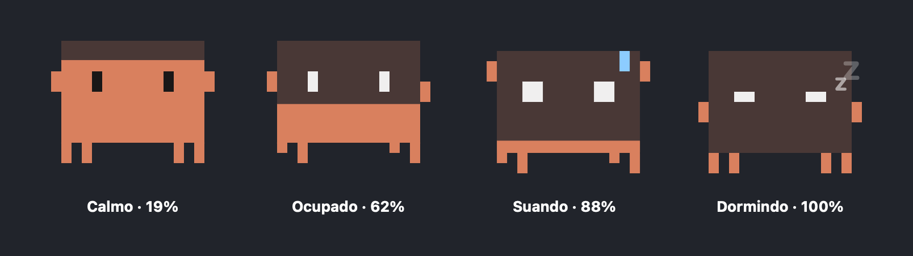

<div align="center">

# Claude Usage Bar

**Um mascote pixel-art na barra de menu do seu Mac que mostra quanto do limite do Claude Code você já gastou.**

[English](README.md) · [Português](README.pt-BR.md)



</div>

---

Já bateu no limite do Claude Code no meio do trabalho, sem aviso? O **Claude Usage Bar** deixa sua janela de 5 horas e o limite semanal a um olhar de distância — e ainda é divertido.

O mascote **é** o medidor: o corpo dele é um tanque que esvazia conforme você gasta, e o humor mostra como você está.

| Uso | Humor | O que faz |
|---|---|---|
| < 45% | 😌 Calmo | Pisca, pula e às vezes acena |
| 45–80% | ⌨️ Ocupado | Digita, perninhas marchando |
| 80–99% | 😅 Suando | Treme, mãos pra cima, olhos arregalados, gota de suor |
| 100% | 😴 Dormindo | Tanque vazio, olhos fechados, *zzz* |

## Recursos

- 🟠 **Medidor na barra de menu** com ícone + `%` da janela de 5h, atualizado sozinho
- 🎯 **Painel com detalhes**: anel com gradiente, "restam X%", tempo até renovar e limite semanal
- 🔮 **Previsão de ritmo**: *"Nesse ritmo, o limite acaba às 13:40"*
- 🔔 **Notificações** em 80% e 95% (uma vez por janela)
- 🚀 **Abre junto com o Mac**
- 🪶 **Levíssimo**: ~0% de CPU, poucos MB de RAM, uma requisição a cada 90 s
- 🔒 **Privado**: sem telemetria, sem contas, sem servidores de terceiros

## Instalação

> O app ainda não é notarizado pela Apple (exige conta de desenvolvedor paga), então o macOS avisa na primeira vez.

1. Baixe o `ClaudeUsageBar-x.y.z.dmg` mais recente em [**Releases**](../../releases).
2. Arraste **Claude Usage** para **Aplicativos**.
3. Primeira abertura: **clique direito → Abrir → Abrir** (ou `xattr -dr com.apple.quarantine "/Applications/Claude Usage.app"`).
4. Aceite o pedido do **Keychain** (para ler seu login do Claude Code) e as **notificações**.

**Requisitos:** macOS 14 Sonoma+ · [Claude Code](https://claude.com/claude-code) instalado e logado.

## Como funciona

O Claude Code guarda o login no Keychain do macOS. O app lê esse token e consulta o mesmo endpoint de uso do comando `/usage` do Claude Code. Só isso.

> ⚠️ Esse endpoint **não é documentado** e pode mudar sem aviso. Se mudar, o app mostra o último valor conhecido e um erro.

## Privacidade

- O token é lido do Keychain **localmente** e enviado **apenas** para `api.anthropic.com`.
- Sem analytics, sem relatório de falhas, sem telemetria.
- O código tem ~600 linhas de Swift. Leia: [`Sources/ClaudeUsageBar`](Sources/ClaudeUsageBar).

## Compilar do código-fonte

```bash
git clone https://github.com/YOUR_USER/claude-usage-bar.git
cd claude-usage-bar
./build.sh --install     # compila, copia para ~/Applications e abre
./scripts/make-dmg.sh    # opcional: gera dist/*.dmg e .zip
```

Só precisa das **Command Line Tools** do Xcode.

## Aviso

Projeto **não oficial** da comunidade, sem afiliação com a Anthropic. "Claude" e "Claude Code" são marcas da Anthropic, PBC. O mascote é uma homenagem ao personagem do terminal do Claude Code.

## Licença

[MIT](LICENSE)
